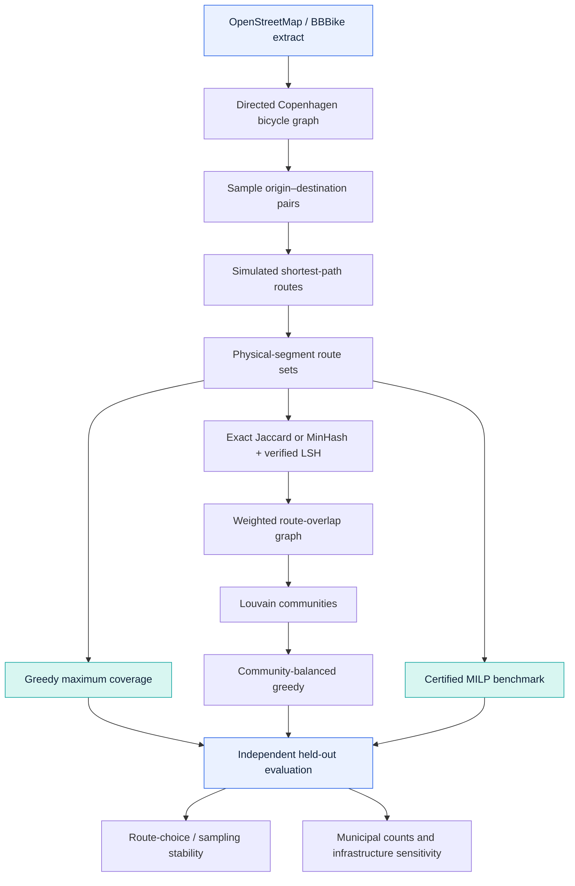
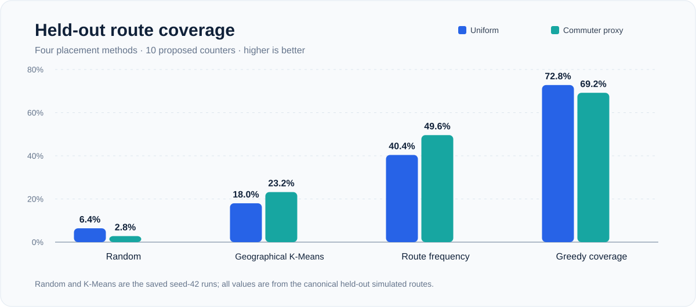
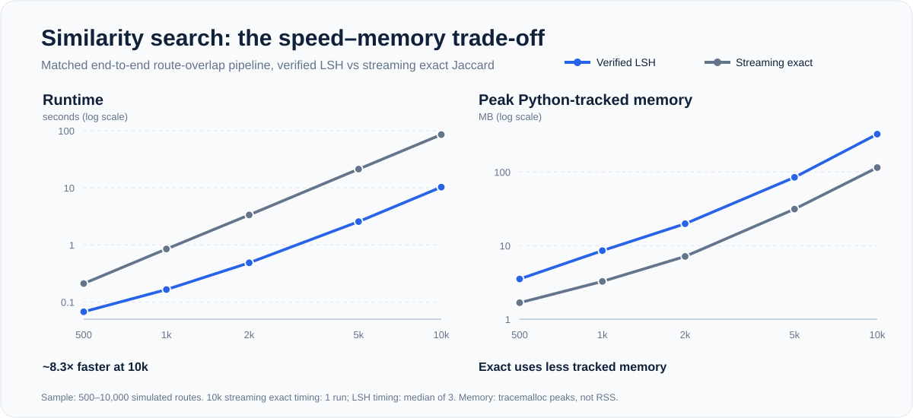

<div align="center">


# CycleSense CPH

**Simulated-route coverage and graph-aware bicycle-counter placement in Copenhagen**

[](https://github.com/amedeone03/cyclesense-cph/actions/workflows/tests.yml)


*DTU 02807 · Computational Tools for Data Science · Autumn 2026*

[**Explore the notebook**](notebooks/analysis.ipynb) · [**Report draft**](report/report.pdf) · [**Research documentation**](docs/) · [**Reproducibility**](docs/reproducibility.md)

</div>

---

## Overview

**Where should a limited number of bicycle counters be placed on Copenhagen's street network to cover as many plausible routes as possible?** CycleSense CPH investigates this question through a reproducible computational study, combining network modeling, similarity search, community detection, optimization, and sensitivity analysis.

The project has two distinct data layers: **mapped streets from OpenStreetMap** and **simulated bicycle journeys** generated on those streets. Published municipal bicycle counts provide an external reference, but not route-level ground truth.

> **Interpretation:** Every coverage percentage in this README is a share of *simulated routes* intersecting at least one selected physical street segment. It is **not** a measured cyclist-capture rate or an approved counter installation plan.

### Research at a glance

| Network | Simulated routes | Candidate locations | External reference |
| :---: | :---: | :---: | :---: |
| **1,157** nodes · **2,732** directed edges | **1,500** canonical routes across two scenarios | **1,047** eligible physical segments | **26** name-verified municipal counting locations |
| 1,698 physical segments | 500 calibration + 250 held-out per scenario | Budgets of 5, 10, 20 and 30 counters | Observed bicycle AADT; distinct from modeled coverage |

### Questions addressed

1. **Optimization quality** — How does greedy maximum coverage compare with geographical and frequency baselines, and with a certified MILP optimum?
2. **Efficient graph computation** — Can **MinHash / Locality-Sensitive Hashing (LSH)** preserve Jaccard route similarities, Louvain communities, and downstream placements while reducing runtime?
3. **Robustness and stability** — How much do results change under new origin–destination samples, alternative route choices, and infrastructure constraints?
4. **Practical interpretation** — How do the simulated placements compare with published municipal counting locations, and what are the limits of that comparison?

## Methodology



### 1 · Counter placement as maximum coverage

Let `C` be the eligible physical street segments and `R` the simulated calibration routes. A proposed set `S \subseteq C` contains at most `K` counter locations. If `E(r)` denotes the physical segments traversed by route `r`, we maximize

$$
\max_{S\subseteq C,\;|S|\le K}
F(S)
=\sum_{r\in R}w_r\,
\mathbf{1}\!\left[E(r)\cap S\ne\varnothing\right],
\qquad w_r\ge 0.
$$

Each route contributes **at most once**, even when several counters are on its path. Standard greedy selects the segment with the largest uncovered weighted-route gain at each step. For this fixed monotone submodular objective under a cardinality constraint,

$$
F(S_{\mathrm{greedy}})\ge
\left(1-\frac{1}{e}\right)F(S^\star).
$$

We independently check greedy against **binary mixed-integer linear programming (MILP)** solved with SciPy/HiGHS. This certifies calibration optimality for the *defined objective*, not real-world installation quality.

### 2 · Route similarity with MinHash, LSH and Louvain

A route is represented as a **set of physical street segments**. For two routes `A` and `B`, exact Jaccard similarity is

$$
J(A,B)=\frac{|A\cap B|}{|A\cup B|}.
$$

MinHash estimates this overlap by the agreement of signatures. With `b` independent bands of `r` signature rows, the idealized probability that a pair of Jaccard similarity `s` is proposed as an LSH candidate is

$$
P_{\mathrm{candidate}}(s)=1-\left(1-s^r\right)^b.
$$

**Every retained LSH candidate is checked using exact Jaccard.** Verified similarities at the chosen threshold become edges of a route-overlap graph. Louvain detects route communities; community-balanced greedy tests whether equalizing representation across non-singleton communities improves placement.

### 3 · Independent evaluation

Both simulated OD scenarios use **500 calibration** and **250 held-out** routes. Calibration selects placements, LSH settings, and route communities; held-out routes evaluate those decisions. Separate studies examine new OD samples, perturbed path costs, repeated placement selection, larger route sets, OSM infrastructure tags, and published municipal counts.

## Selected findings

### Greedy performs strongly on held-out simulated routes



*Canonical held-out routes at `K=10`. Random and geographical K-Means bars correspond to the saved **seed-42** runs, not multi-seed means; route frequency and greedy are deterministic.*

At `K=10`, uniform greedy achieves **72.8%** held-out coverage, compared with **40.4%** for frequency ranking. The MILP benchmark proves that standard greedy reaches the **same optimal calibration objective at K=5 and K=10** for both scenarios. At larger budgets, the measured absolute gap is at most **0.8 percentage points**.

**A crucial negative result:** two different solutions can have identical calibration coverage and different held-out coverage. For uniform `K=10`, greedy and an independently solved MILP placement both achieve **74.0%** on calibration routes, but **72.8%** and **68.8%**, respectively, on held-out routes.

### Verified LSH is faster, not always more memory-efficient



*Measured nested samples of 500–10,000 simulated routes. The 10,000-route streaming-exact timing is a **single run**; verified-LSH timing is the median of three. Memory is **peak Python-tracked allocations (tracemalloc)**, not process RSS.*

At 10,000 routes, the verified LSH pipeline took **10.28 seconds** versus **85.29 seconds** for streaming exact Jaccard (approximately **8.3× faster**). Its candidate search avoids most of the roughly 50 million possible pairs, but **streaming exact uses less Python-tracked memory**. LSH approximation also changes some Louvain partitions and sometimes counter sets, so speed must be evaluated alongside recall and downstream effects.

### Communities and robustness reveal trade-offs

| Study | Finding |
| --- | --- |
| **Louvain-balanced placement** | At uniform `K=10`, `\lambda=0.25` scores **72.4%** held-out coverage versus **72.8%** for ordinary greedy; commuter proxy is **66.8%** versus **69.2%**. Community balancing does **not** consistently improve generalization. |
| **Alternative route choices** | Uniform greedy `K=10` coverage decreases from **72.8%** on the saved shortest paths to **65.7%** under the 15% detour experiment. |
| **30 independent calibration draws** | Only the **Knippelsbro / Børsgade** physical segment is selected in every uniform `K=10` draw. The mean pairwise selected-set Jaccard similarity is **0.27**. |
| **Route-choice-aware training** | Training on simulated detours does not consistently improve held-out coverage over a fair pooled-shortest-path baseline. |
| **Mapped infrastructure filters** | At uniform `K=10`, restricting to tagged facilities reduces coverage to **68.4%**; dedicated-cycleway-only candidates give **30.0%**. These are hypothetical OSM-tag filters, **not installation rules**. |

### Published municipal sites: useful benchmark, limited validation

The project matches **26** recurring bicycle counting locations from Københavns Kommune's published **Trafiktal** snapshot to physical network segments.

| Uniform held-out simulated routes | Coverage |
| --- | ---: |
| 26 matched municipal counting locations | **73.6%** |
| 26 locations + 5 greedy additions | **83.6%** |
| 26 locations + 10 greedy additions | **87.2%** |

The modeled ranking of route traversal versus observed bicycle AADT has a weak Spearman association (approximately **`\rho=0.26`**). Notably, **Dronning Louises Bro** has a high published bicycle count but zero modeled traversal within the clipped pilot. The improvement from proposed additions is therefore a **simulation result**, not a forecast of additional cyclists recorded.

A separate Shapley analysis attributes each simulated covered route equally across the municipal sites it traverses. This distinguishes **unique coverage**, **shared modeled coverage**, and **direct traversal**; it does not determine whether an actual municipal counting site is redundant.

**Takeaway:** Near-optimal computation is achievable on this model, but the **route-generation assumptions, selection stability, study boundary, and external validity** dominate the practical uncertainty.

## Reproduce the research notebook

The final notebook is the **recommended starting point for teammates and examiners**. It contains executable small examples of the project's own greedy, MILP, Jaccard, MinHash–LSH, Louvain, and Shapley code, together with tables exported from validated Copenhagen experiments.

### Installation

Requires **Python 3.11+**. From the repository root:

```bash
git clone https://github.com/amedeone03/cyclesense-cph.git
cd cyclesense-cph

python3 -m venv .venv
source .venv/bin/activate          # macOS / Linux
python -m pip install --upgrade pip
python -m pip install -e '.[analysis,dev]'
```

### Open the notebook

```bash
jupyter lab notebooks/analysis.ipynb
```

Select **Run All Cells**, or execute the same checks from the terminal:

```bash
python scripts/validate_notebook.py
python -m pytest -q
ruff check src scripts tests
python scripts/reproduce.py --mode smoke
```

The notebook's **21 lightweight asset files** are included at [`notebooks/assets/`](notebooks/assets/), with source SHA-256 provenance in [`provenance.json`](notebooks/assets/provenance.json). It runs **without** the original OSM PBF or large local experiment outputs; only the optional street-map cell is skipped when GraphML is absent.

The last recorded audit executed all 14 code cells in a clean Python 3.14 environment and passed **193 tests** locally. GitHub Actions separately tests the code on Python 3.11; it does **not** execute the full notebook.

### Where to look next

| Resource | Purpose |
| --- | --- |
| [`notebooks/analysis.ipynb`](notebooks/analysis.ipynb) | Complete executable academic walkthrough |
| [`report/report.tex`](report/report.tex) / [`report/report.pdf`](report/report.pdf) | **Report draft** for team editing |
| [`docs/research_plan.md`](docs/research_plan.md) | Hypotheses, assumptions and evaluation design |
| [`docs/m3_communities.md`](docs/m3_communities.md) | Exact Jaccard, verified LSH and Louvain |
| [`docs/exact_optimization.md`](docs/exact_optimization.md) | Certified greedy–MILP benchmark |
| [`docs/scalability_study.md`](docs/scalability_study.md) | Timing/memory experiment and its limitations |
| [`docs/placement_stability.md`](docs/placement_stability.md) | Repeated calibration selection and stability |
| [`docs/standout_extension.md`](docs/standout_extension.md) | Municipal count matching and complementary sites |
| [`docs/municipal_redundancy.md`](docs/municipal_redundancy.md) | Leave-one-out and Shapley attribution |
| [`docs/reproducibility.md`](docs/reproducibility.md) | Complete source, hash, and rerun protocol |

<details>
<summary><strong>Repository structure and optional interactive planner</strong></summary>

```text
src/cyclesense/             Algorithms and graph/plot utilities
scripts/                    Experiment, validation and export commands
notebooks/analysis.ipynb    Final research notebook
notebooks/assets/           Portable validated result tables
report/                     Report DRAFT, PDF and figures
docs/                       Detailed methodological records
configs/                    Parameters, seeds and provenance manifest
snapshots/                  Frozen municipal Trafiktal (CC0)
tests/                      Automated tests
data/, outputs/, cache/     Large local artifacts, ignored by Git
```

The [interactive what-if planner](docs/planner.md) compares saved budgets, methods, scenarios, stability heatmaps and municipal additions; it does not rerun optimization. **It requires the full local `data/` and `outputs/` trees** and cannot be regenerated from a clean clone using only notebook assets.

```bash
python scripts/map_planner.py
python -m http.server 8765 --bind 127.0.0.1
```

Open `http://127.0.0.1:8765/outputs/planner/cyclesense_planner.html`.

The full saved-results consistency check is `python scripts/validate_results.py`; unlike the notebook validator, it requires the gitignored study-output tree. Do not expect it to pass on a clean clone.

</details>

## Data provenance and limitations

| Dataset | Provenance and availability |
| --- | --- |
| **OpenStreetMap cycling network** | Mapped street data © OpenStreetMap contributors (ODbL), obtained via [BBBike Copenhagen](https://download.bbbike.org/osm/bbbike/Copenhagen/). The original 14 November 2026 extract is **not committed**; its SHA-256 is recorded in [`configs/reproducibility.yaml`](configs/reproducibility.yaml). The live URL can change. |
| **Simulated routes and full experiment outputs** | Generated locally using recorded scenario assumptions/seeds. Full `data/`, `cache/` and `outputs/` are gitignored; exact full-network rebuilding requires the historical PBF or saved GraphML. |
| **Municipal traffic counts** | [Københavns Kommune Trafiktal](https://www.opendata.dk/city-of-copenhagen/trafiktal), CC0; frozen [21 November 2026 CSV](snapshots/trafiktal-2026-11-21.csv). The 26 matched locations are recurring count sites, not a confirmed inventory of permanent sensors. |
| **Portable computational evidence** | Tracked [notebook assets](notebooks/assets/) exported from saved validated runs, with source hashes and metadata. No heavy benchmark is run when the notebook opens. |

The pilot boundary cuts off journeys; OD pairs are sampled rather than observed; alternative routes are simulated; missing OSM cycleway tags do not establish absence of facilities; and neither high Shapley attribution nor high selection frequency proves real-world installation value. **These limitations are part of the findings, not implementation errors.**

## For teammates — report handover

**Implementation and computational experiments are complete.** The academic report is intentionally a **draft** for the group to revise and submit.

1. Open [`report/report.tex`](report/report.tex) and [the compiled draft](report/report.pdf). Use the [notebook](notebooks/analysis.ipynb) and the `docs/` records to verify claims and reuse figures.
2. Replace **`[Group member names]`** and the individual-contributions placeholder with real names and accurate descriptions. No names or contributions have been invented.
3. Recompile the PDF and check the **rendered** non-whitespace character count. The official 2026 limits are **11,000** for four members and **12,500** for five. The last conservative audit reported about **10,937 characters including the contribution appendix**, leaving little space at the four-person limit. `scripts/count_report.py` is a LaTeX-source proxy and can **undercount figure labels**.
4. Review the report's five figures, references, mathematical explanations, and negative results. The draft is **six pages**; the final team should assess conciseness and visual readability.
5. Build and verify the final hand-in package after edits. **GitHub is not the DTU Learn submission.** The project deadline is **4 December 2026 at 23:59**.

For the report, focus on the central argument: **greedy solves the simulated coverage problem well; LSH provides a computational speed trade-off; Louvain's diversity reweighting is not a consistent gain; and the assumptions behind simulated routes limit real-world interpretation.**

---

<sub>**Attribution:** OpenStreetMap contributors (ODbL) · Københavns Kommune Trafiktal (CC0). Methodological references for maximum coverage, MinHash/LSH, Louvain, and evaluation appear in the [academic report](report/report.pdf) and [analysis notebook](notebooks/analysis.ipynb).</sub>
